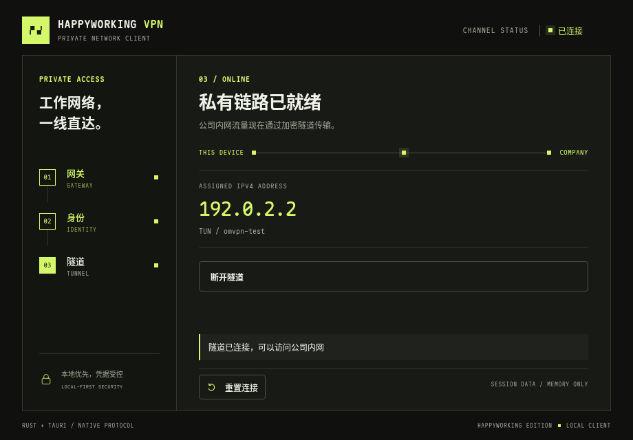
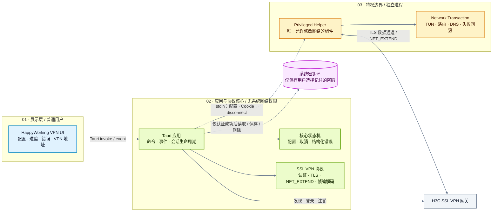
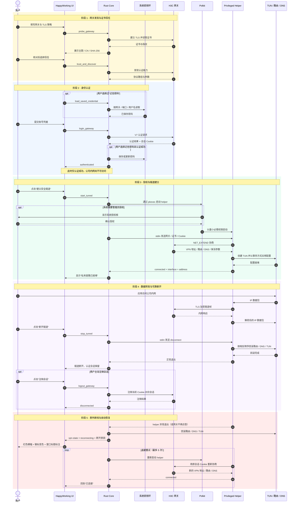

<div align="center">

# HappyWorking VPN

**注重清晰体验与安全边界的 H3C iNode SSL VPN 桌面客户端**

基于 Rust 与 Tauri，提供证书确认、账号认证、隧道建立、网络配置和可靠断开的一体化体验。




</div>

## 为什么做 HappyWorking VPN

本人长期使用Arch系的Linux桌面操作系统工作，公司使用的VPN客户端提供的Linux安装包依赖非常旧，存在各种兼容问题 ，于是重写一个。
HappyWorking VPN 从实际协议行为出发，使用 Rust 与 Tauri 独立实现客户端，让连接过程更清楚、网络清理更可靠，并为后续 macOS 和 Windows 支持保留统一的产品与核心协议边界。

## 核心特性

- **完整连接流程**：网关发现、证书指纹确认、账号认证、NET_EXTEND 协商、TUN 建立、路由与 DNS 下发。
- **断线可知可恢复**：隧道意外中断时界面立即变红提示，窗口标题同步标注，并在退避重试中自动重建隧道。
- **可靠的断开清理**：主动断开、网关注销、异常退出和主程序关闭时，回滚本客户端添加的网络配置。
- **最小权限设计**：界面以普通用户运行，仅特权 helper 通过系统授权获取网络配置权限。
- **本地凭据保护**：密码默认不持久化；选择“记住密码”后使用系统密钥环。
- **明确的证书信任**：展示并核对 SHA-256 指纹，不通过全局关闭证书校验来绕过问题。
- **特定网关兼容模式**：仅在用户明确选择时调整 OpenSSL 安全级别。
- **清晰的桌面体验**：单步操作、连接进度、错误原因、VPN 地址与接口状态均直接显示。
- **异步原生实现**：Rust + Tokio 数据通道，非阻塞 TUN I/O，有明确的帧长度与网络输入边界。

## 当前兼容性

项目对“已实现”和“已实测”作明确区分，不把协议样例测试当作真实网关兼容性证明。

| 能力 | 当前状态 |
| --- | --- |
| H3C iNode SSL VPN V7 密码认证 | 已在目标网关实测 |
| NET_EXTEND 与 TUN 数据隧道 | 已实测，可访问公司内网 |
| HTTP 响应头及正文中的网络配置解析 | 已实现并覆盖自动化测试 |
| 公司路由、DNS 配置与断开回滚 | 已实测 |
| 长时间连接与主动断开 | 已在目标环境验收 |
| 二次认证流程 | 已实现，具有自动化测试；尚未在真实网关触发验收 |
| V3 协议路径 | 具有协议实现与自动化测试；尚未完成真实网关验收 |
| 802.1X / Portal | 尚未纳入当前可用版本 |
| 当前桌面构建 | 已在现有 x86_64 桌面环境实测 |
| macOS | 后续支持，尚未提供可用版本 |
| Windows | 后续支持，尚未提供可用版本 |

## 快速开始

### 环境要求

- Rust 1.85 或更新版本
- Node.js 22 或更新版本
- GNU Make
- 当前桌面构建所需的系统 WebView、C/C++ 构建工具、OpenSSL 与 pkg-config
- 当前网络后端所需的 Polkit、iproute2 和 systemd-resolved

跨平台支持会通过独立的系统网络后端逐步提供；上述网络工具不是 macOS 或 Windows 版本的依赖承诺。

### 一键构建

```bash
make
```

`make` 会按锁文件安装前端依赖，完成前端构建和正式 Tauri 构建。产物位于：

```text
target/release/happyworking-vpn-app
target/release/happyworking-vpn-helper
```

当前发布结果由主程序和配套特权 helper 组成，**不是单文件静态二进制**。运行主程序即可，但两个文件必须保持在同一目录；系统 WebView、OpenSSL 等动态依赖由运行环境提供。

### 构建并运行

```bash
make run
```

### 其他 Make 目标

| 命令 | 作用 |
| --- | --- |
| `make` / `make build` | 一键安装锁定依赖并构建正式版本 |
| `make release` | 构建发布版本，等同于 `make build` |
| `make run` | 构建并启动应用 |
| `make test` | 运行格式检查、Clippy、Rust 测试、前端测试和类型检查 |
| `make clean` | 清理 Cargo 与前端构建产物，不删除依赖目录 |

也可以单独启动开发环境：

```bash
npm ci
npm run dev
```

## 使用方式

1. **读取网关证书**：填写配置名称、网关地址、端口和 TLS 策略。
2. **核对证书**：确认主题、通用名称及 SHA-256 指纹与管理员提供的信息一致。
3. **完成身份认证**：输入账号信息；按需选择是否将密码保存到系统密钥环。
4. **建立隧道**：通过系统授权，让特权 helper 配置 TUN、路由和 DNS。
5. **访问公司内网**：界面显示“私有链路已就绪”、VPN 地址和接口名称后即表示数据面已建立。
6. **断开或重置**：主动断开隧道并保留认证会话，或重置连接以清空本地会话状态。
7. **断线自动恢复**：隧道意外中断时，界面会变红并提示断开原因，客户端自动退避重连；重连成功直接回到“已连接”，会话失效时再手动重连或重置连接。

> “认证成功”只表示凭据已被接受。只有隧道建立完成后，公司内网流量才会经过 VPN。

## 架构概览

下图按**权限边界**而不是仅按编程语言分层：界面和协议核心保持无特权，只有独立 helper 能修改系统网络。



> 实线表示控制或协议链路，虚线表示跨越敏感数据 / 权限边界的受控通道。Cookie 只进入内存和 helper 标准输入，不写入配置文件。

| 路径 | 职责 |
| --- | --- |
| `src/` | TypeScript 界面、状态呈现与交互 |
| `src-tauri/` | Tauri 命令、会话生命周期及特权 helper |
| `crates/core/` | 配置、状态机、结构化错误、敏感值与证书指纹 |
| `crates/sslvpn/` | V3/V7 认证、TLS、NET_EXTEND、隧道帧与数据转发 |
| `crates/netops/` | TUN、路由、DNS 抽象、当前系统实现及事务回滚 |
| `tests/` | 基于 Chromium DevTools 的真实前端流程测试 |
| `Makefile` | 一键构建、运行、测试和清理入口 |

更多能力与验证边界见 [CAPABILITY_MAP.md](./CAPABILITY_MAP.md)。

## 网络连接时序

不同颜色对应四个阶段：**证书确认、身份认证、隧道建立、数据转发与断开**。关键分支使用 `opt` 标注，避免把可选步骤理解为每次都会发生。



> 如果主程序退出，helper 会从标准输入读到 EOF 并进入同一清理路径；如果网关注销或隧道帧异常，界面会显示失败原因，而不是把“已认证”误报为“可访问内网”。意外断线不会停在“已连接”：客户端会标明断开原因、退避重连，重连成功直接恢复，重试耗尽则交回手动重连或重新登录。

## 安全设计

- 主界面不直接以管理员身份运行；需要特权的网络操作集中在独立 helper。
- 主程序通过受控标准输入通知 helper 断开，而非跨权限边界强制结束进程。
- helper 的标准输入关闭时也会触发清理，降低主程序退出后遗留网络配置的风险。
- 会话 Cookie 仅保存在内存中；日志与错误类型对已知敏感值进行脱敏。
- 密码只有在用户明确选择并认证成功后才写入系统密钥环；取消记住后的成功登录会删除对应旧凭据。
- 证书指纹由用户确认；诊断 CLI 也要求提供预期指纹。
- `.analysis/`、证书私钥、账号密码、Cookie 和本地日志均不纳入版本控制。

## 测试与质量检查

一键执行完整检查：

```bash
make test
```

也可以分别运行：

```bash
cargo fmt --all --check
cargo clippy --workspace --all-targets -- -D warnings
cargo test --workspace

npm test
npm run check
npm run build
```

前端测试使用 Chromium，因此执行 `npm test` 前需要确保 `chromium` 在 `PATH` 中。测试通过独立临时浏览器配置运行，不读取日常浏览器会话。

Secret Service 的真实读写测试默认忽略，避免测试过程触碰用户密钥环；需要时应在本机显式运行对应测试。

## 贡献

欢迎围绕跨平台网络后端、协议兼容性、错误诊断和界面体验提交改进。

提交前请：

1. 运行 `make test`。
2. 清楚区分自动化测试、静态协议恢复和真实网关验证。
3. 不提交 `.analysis/`、厂商客户端二进制、账号密码、Cookie、私钥或真实会话数据。
4. 不通过删除测试、跳过证书验证或扩大全局权限来掩盖问题。

## 许可证与声明

本项目按 **Apache-2.0** 许可证发布，完整文本见 [LICENSE](./LICENSE)。

HappyWorking VPN 是独立实现，与 H3C 无关，也不是官方 iNode 客户端。H3C 与 iNode 名称仅用于描述兼容目标，相关权利归各自所有者。使用前请确认你拥有访问目标网关的授权，并遵守所在组织的网络与安全策略。
